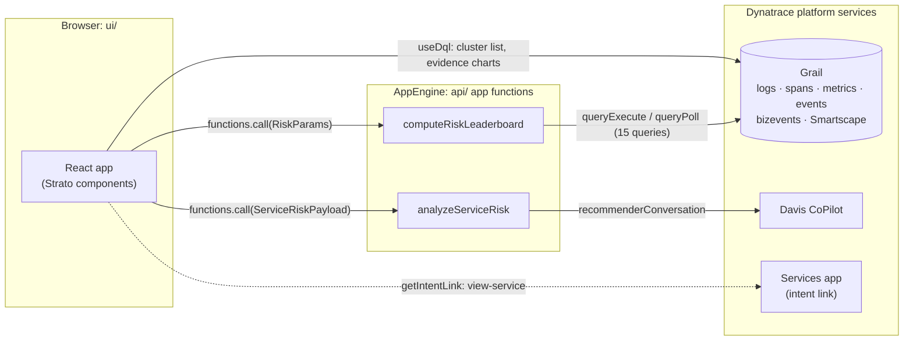
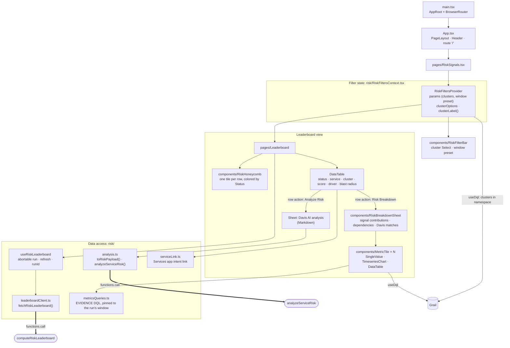
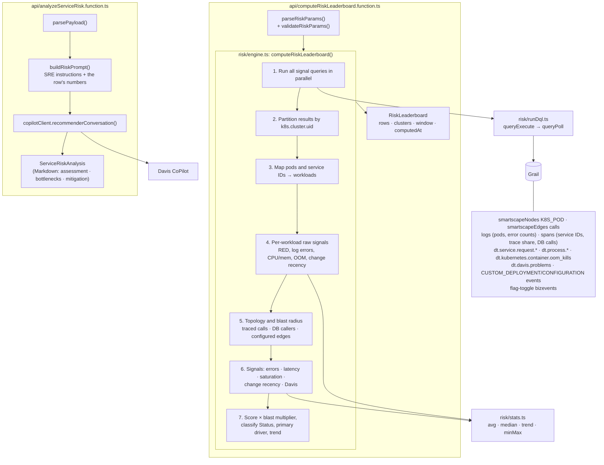

# Getting Started with your Dynatrace App

This project was bootstrapped with Dynatrace App Toolkit.

It uses React in combination with TypeScript, to provide great developer experience.

## Architecture

Service Risk Analysis scores every EasyTrade service (per Kubernetes cluster) with a composite 0–100 risk score
and lets you drill into the evidence or ask Davis CoPilot for an analysis. The app has two halves:

- **Frontend** (`ui/`): React + Strato, running in the browser inside the Dynatrace platform.
- **Backend** (`api/`): two app functions running in the Dynatrace JavaScript runtime (AppEngine). The UI calls
  them through `functions.call()` from `@dynatrace-sdk/app-utils`.

The scoring is done server-side, so the browser makes one function call per run instead of fifteen DQL queries.
Light, interactive queries (the cluster list and the evidence charts) run in the browser with `useDql`.

### System overview

### Frontend logical architecture

- **`RiskFiltersProvider`** holds the only user input, `RiskParams` (selected clusters plus lookback and compare
  hours from a window preset). It also loads the cluster list with a cheap metrics query.
- **`useRiskLeaderboard`** re-runs the scoring only when the parameter *values* change, aborts superseded runs,
  and exposes `refresh()`. `runId` increments per result so the table remounts with fresh defaults.
- **Leaderboard** renders the honeycomb and table from the same `RiskRow[]`. Each row already carries its
  `breakdown`, so the Risk Breakdown sheet needs no extra function call. Only its evidence charts query Grail,
  and they are pinned to the run's window so they match the scores.

### Backend architecture (app functions)

- **`computeRiskLeaderboard`** is a TypeScript port of the dashboard Code tile
  (`monaco/dashboards/risk-leaderboard-tile.js`). Each cluster is scored independently. Scoring logic changes
  must be applied to **both** files (see the header of `api/risk/engine.ts`). One run scans about 0.8 GB of
  Grail data for one cluster at 24h, scaling with the window length.
- **`analyzeServiceRisk`** is stateless. It turns one row's numbers into a CoPilot prompt and returns the
  Markdown answer.

### Shared contracts

The UI and the functions share types and helpers instead of duplicating them. The functions import from `ui/`:

| File | Used by | Purpose |
|---|---|---|
| `ui/app/risk/riskContract.ts` | UI + `computeRiskLeaderboard` | `RISK_CONFIG` (weights, namespace), `RiskParams`, `RiskRow`, `RiskLeaderboard`, validation |
| `ui/app/risk/analysisContract.ts` | UI + `analyzeServiceRisk` | `ServiceRiskPayload`, `ServiceRiskAnalysis` |
| `ui/app/risk/dql.ts` | UI + engine | Typed accessors for DQL result records |

Required permissions for the Grail reads, function calls and CoPilot are declared in `app.config.json` (`scopes`).

## Available Scripts

In the project directory, you can run:

### `npm run start`

Runs the app in the development mode. A new browser window with your running app will be automatically opened.

Edit a component file in `ui` and save it. The page will reload when you make changes. You may also see any errors in the console.

### `npm run build`

Builds the app for production to the `dist` folder. It correctly bundles your app in production mode and optimizes the build for the best performance.

### `npm run deploy`

Builds the app and deploys it to the specified environment in `app.config.json`.

### `npm run uninstall

Uninstalls the app from the specified environment in `app.config.json`.

### `npm run generate:function`

Generates a new serverless function for your app in the `api` folder.

### `npm run update`

Updates @dynatrace-scoped packages to the latest version and applies automatic migrations.

### `npm run info`

Outputs the CLI and environment information.

### `npm run help`

Outputs help for the Dynatrace App Toolkit.

## Learn more

You can find more information on how to use all the features of the new Dynatrace Platform in [Dynatrace Developer](https://dt-url.net/developers).

To learn React, check out the [React documentation](https://reactjs.org/).
